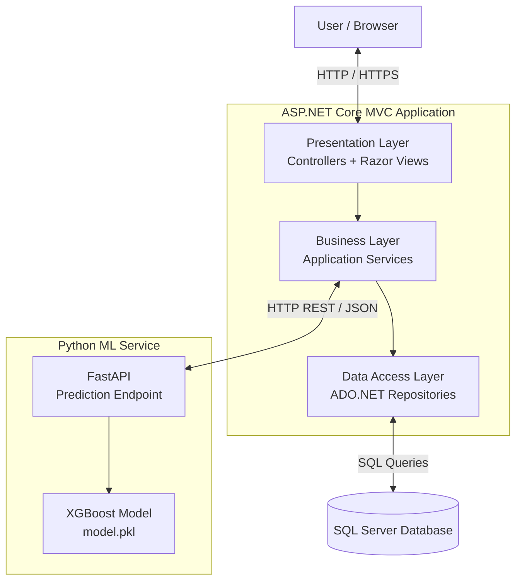
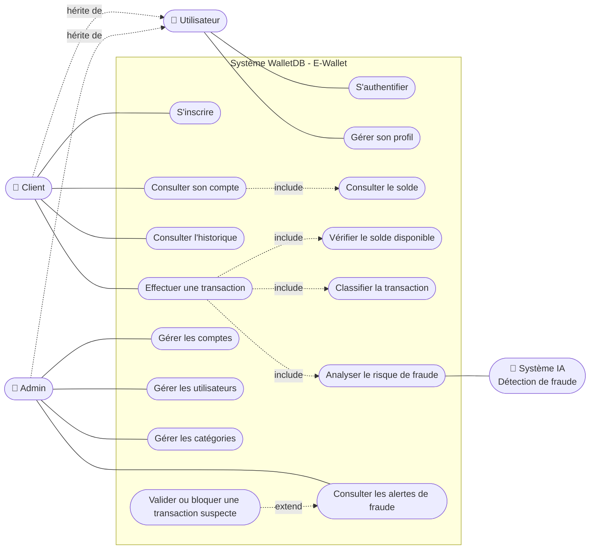
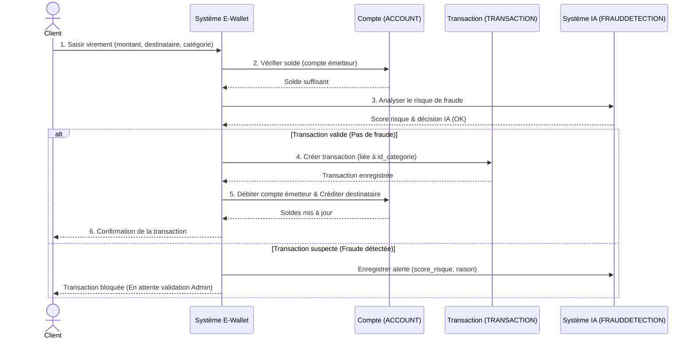
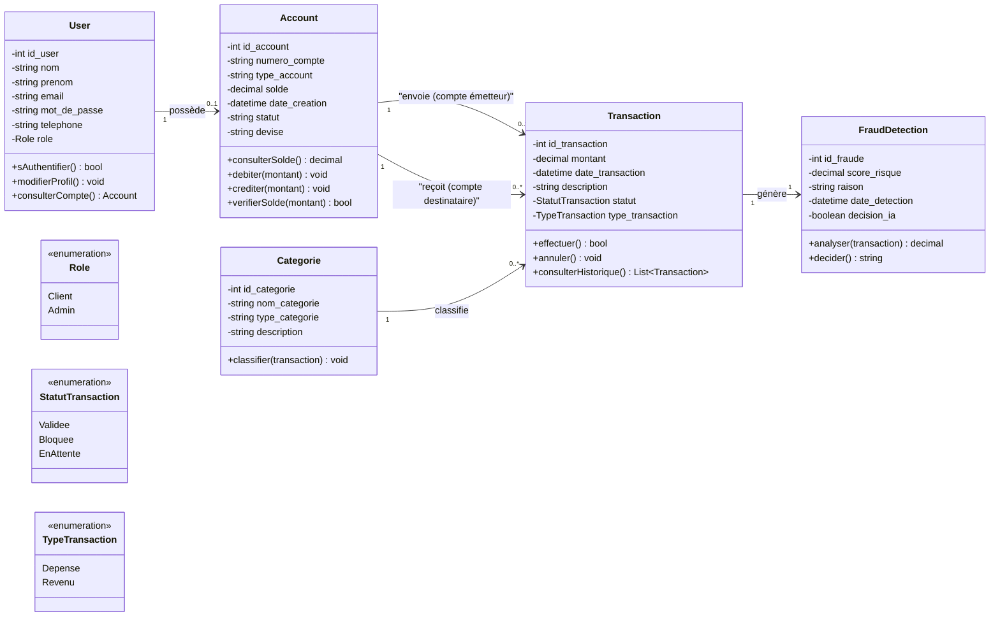
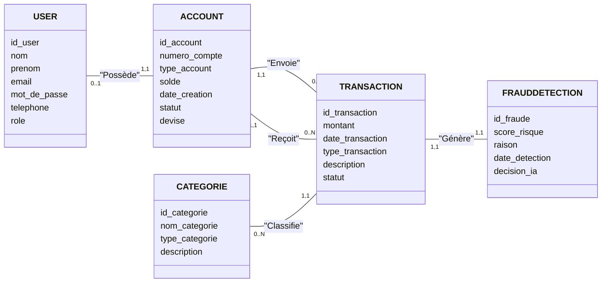
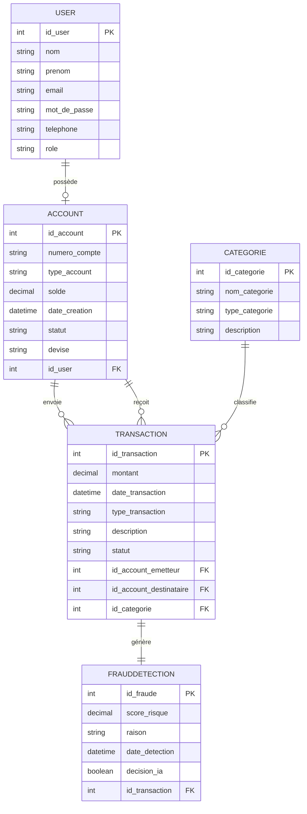

# Plateforme E-Wallet

## 1. Présentation du projet

E-Wallet est une plateforme de portefeuille électronique permettant aux utilisateurs de gérer leurs transactions financières, de suivre leurs budgets et de contrôler leurs dépenses.

La plateforme intègre un modèle de Machine Learning basé sur **XGBoost** pour détecter les transactions bancaires potentiellement frauduleuses.

## 2. Fonctionnalités

- Gestion des comptes utilisateurs.
- Gestion des portefeuilles électroniques.
- Gestion et suivi des transactions financières.
- Suivi du solde du portefeuille.
- Gestion des budgets personnels.
- Historique et suivi des dépenses.
- Détection des fraudes basée sur l'intelligence artificielle.

## 3. Technologies utilisées

| Composant | Technologie |
|---|---|
| Frontend | HTML, Tailwind CSS, Flowbite |
| Backend | ASP.NET Core MVC, ADO.NET |
| Base de données | Microsoft SQL Server |
| Intelligence artificielle / ML | Python, XGBoost |
| Gestion de versions | Git, GitHub |

## 4. Architecture

L'application repose sur une architecture client-serveur organisée en plusieurs couches :

- **Couche présentation :** ASP.NET Core MVC, Razor Views, Tailwind CSS et Flowbite.
- **Couche applicative :** Contrôleurs et services assurant la logique métier.
- **Couche d'accès aux données :** ADO.NET pour communiquer avec la base de données.
- **Couche données :** SQL Server pour stocker les utilisateurs, les portefeuilles et les transactions.
- **Couche IA :** Modèle XGBoost pour la détection des transactions frauduleuses.



## 5 La conception

## 5.1. Conception  Uml

## 5.1.1 Diagramme de Cas d'Utilisation

## 5.1.2 Diagramme de Séquence



## 5.1.3 Diagramme de Classes




 ## 5.2. Conception de la base de données

La base de données repose principalement sur les entités suivantes :

FraudDetectionResults (_id_fraud_, score_risque, raison, date_detection, decision_IA, #id_transaction)  -- #id_transaction UNIQUE

## 5.2.1 Modèle Conceptuel de Données (MCD)



## 5.2.2 Modèle Logique de Données (MLD)


## 5.2.3 Modèle physique de données (MPD)

```sql
-- =============================================
-- MPD - WalletDB (SQL Server)
-- =============================================
CREATE DATABASE WalletDB;
GO
USE WalletDB;
GO

-- ---------------------------------------------
-- Table USERS
-- ---------------------------------------------
CREATE TABLE Users (
    id_user         INT IDENTITY(1,1) NOT NULL,
    nom             NVARCHAR(100)  NOT NULL,
    prenom          NVARCHAR(100)  NOT NULL,
    email           NVARCHAR(150)  NOT NULL,
    mot_de_passe    NVARCHAR(255)  NOT NULL,
    telephone       NVARCHAR(20)   NULL,
    role            NVARCHAR(10)   NOT NULL DEFAULT 'Client',
    CONSTRAINT PK_Users PRIMARY KEY (id_user),
    CONSTRAINT UQ_Users_Email UNIQUE (email),
    CONSTRAINT CK_Users_Role CHECK (role IN ('Client', 'Admin'))
);
GO

-- ---------------------------------------------
-- Table ACCOUNTS
-- ---------------------------------------------
CREATE TABLE Accounts (
    id_account      INT IDENTITY(1,1) NOT NULL,
    numero_compte   NVARCHAR(30)   NOT NULL,
    type_account    NVARCHAR(50)   NOT NULL,
    solde           DECIMAL(18,2)  NOT NULL DEFAULT 0,
    date_creation   DATE           NOT NULL DEFAULT CAST(GETDATE() AS DATE),
    statut          NVARCHAR(20)   NOT NULL DEFAULT 'Actif',
    devise          CHAR(3)        NOT NULL DEFAULT 'MAD',
    id_user         INT            NOT NULL,
    CONSTRAINT PK_Accounts PRIMARY KEY (id_account),
    CONSTRAINT UQ_Accounts_Numero UNIQUE (numero_compte),
    CONSTRAINT FK_Accounts_Users FOREIGN KEY (id_user)
        REFERENCES Users(id_user)
        ON DELETE CASCADE
 CHECK (statut IN ('Actif', 'Inactif', 'Bloque'))
);
GO

-- ---------------------------------------------
-- Table CATEGORIES
-- ---------------------------------------------
CREATE TABLE Categories (
    id_categorie    INT IDENTITY(1,1) NOT NULL,
    nom_categorie   NVARCHAR(100)  NOT NULL,
    type_categorie  NVARCHAR(50)   NOT NULL,
    description     NVARCHAR(255)  NULL,
    CONSTRAINT PK_Categories PRIMARY KEY (id_categorie)
    CHECK (type_categorie IN ('Depense', 'Revenu'))
);
GO

-- ---------------------------------------------
-- Table TRANSACTIONS
-- ---------------------------------------------
CREATE TABLE Transactions (
    id_transaction          INT IDENTITY(1,1) NOT NULL,
    montant                 DECIMAL(18,2)  NOT NULL,
    date_transaction        DATETIME       NOT NULL DEFAULT GETDATE(),
    type_transaction        NVARCHAR(50)   NOT NULL,
    description             NVARCHAR(255)  NULL,
    statut                  NVARCHAR(10)   NOT NULL,
    id_account_emetteur     INT            NOT NULL,
    id_account_destinataire INT            NOT NULL,
    id_categorie            INT            NOT NULL,
    CONSTRAINT PK_Transactions PRIMARY KEY (id_transaction),
    CONSTRAINT CK_Transactions_Montant CHECK (montant > 0),
    CONSTRAINT CK_Transactions_Statut CHECK (statut IN ('Depense', 'Revenu')),
    CONSTRAINT CK_Transactions_Comptes CHECK (id_account_emetteur <> id_account_destinataire),
    -- NO ACTION pour eviter les "multiple cascade paths" sur Accounts
    CONSTRAINT FK_Transactions_Emetteur FOREIGN KEY (id_account_emetteur)
        REFERENCES Accounts(id_account),
    CONSTRAINT FK_Transactions_Destinataire FOREIGN KEY (id_account_destinataire)
        REFERENCES Accounts(id_account),
    CONSTRAINT FK_Transactions_Categories FOREIGN KEY (id_categorie)
        REFERENCES Categories(id_categorie)

);
GO

-- ---------------------------------------------
-- Table FRAUDDETECTION
-- ---------------------------------------------
CREATE TABLE FraudDetection (
    id_fraude       INT IDENTITY(1,1) NOT NULL,
    score_risque    DECIMAL(5,2)   NOT NULL,
    raison          NVARCHAR(255)  NULL,
    date_detection  DATETIME       NOT NULL DEFAULT GETDATE(),
    decision_ia     boolean   NOT NULL,
    id_transaction  INT            NOT NULL,
    CONSTRAINT PK_FraudDetection PRIMARY KEY (id_fraude),
    CONSTRAINT UQ_FraudDetection_Transaction UNIQUE (id_transaction),
    CONSTRAINT CK_FraudDetection_Score CHECK (score_risque BETWEEN 0 AND 100),
    CONSTRAINT FK_FraudDetection_Transactions FOREIGN KEY (id_transaction)
        REFERENCES Transactions(id_transaction)
        ON DELETE CASCADE
);
GO

-- ---------------------------------------------
-- Index pour les performances
-- ---------------------------------------------
CREATE INDEX IX_Accounts_User ON Accounts(id_user);
CREATE INDEX IX_Transactions_Emetteur ON Transactions(id_account_emetteur);
CREATE INDEX IX_Transactions_Destinataire ON Transactions(id_account_destinataire);
CREATE INDEX IX_Transactions_Categorie ON Transactions(id_categorie);
CREATE INDEX IX_Transactions_Date ON Transactions(date_transaction);
GO
```


## 6. Prérequis

- .NET SDK
- Microsoft SQL Server
- SQL Server Management Studio (SSMS)
- Git
- Python (pour le composant Machine Learning)

## 7. Installation

Cloner le dépôt Git :

```bash
git clone git@github.com:idrissAbbou/e_wallet.git
cd e_wallet
```

Restaurer les dépendances du projet :

```bash
dotnet restore
npm install
```

## 8. Configuration

Les éléments suivants doivent être configurés avant le lancement de l'application :

- **Connexion à la base de données :** Configurer la chaîne de connexion SQL Server.
- **Variables d'environnement :** Configurer les paramètres sensibles de l'application.
- **Modèle IA :** Configurer l'intégration du modèle XGBoost.
- **Services externes :** Configurer les éventuelles API nécessaires.

Les identifiants de connexion et les clés API ne doivent pas être publiés dans le dépôt Git.

## 9. Exécution de l'application

Lancer l'application avec la commande suivante :

```bash
dotnet run
```

Accéder ensuite à l'URL locale affichée dans le terminal.

## 10. Structure du projet

```text
e_wallet/
├── Controllers/
│   ├── AccountController.cs
│   ├── AdminController.cs
│   ├── BudgetsController.cs
│   ├── CategoriesController.cs
│   ├── DashboardController.cs
│   ├── HomeController.cs
│   ├── TransactionsController.cs
│   └── WalletsController.cs
├── Data/
│   ├── Database/
│   │   └── DbConnectionFactory.cs
│   ├── Interfaces/
│   │   └── IUserRepository.cs
│   └── Repositories/
│       ├── DatabaseRepository.cs
│       └── UserRepository.cs
├── Database/
│   └── Scripts/
│       ├── 001_CreateDatabase.sql
│       ├── 002_CreateTables.sql
│       ├── 004_AddConstraintes.sql
│       ├── 004_CreateIndexes.sql
│       ├── 005_dataSeed.sql
│       └── CheckScripts.sql
├── Models/
│   ├── Entities/
│   │   └── User.cs
│   └── ErrorViewModel.cs
├── Properties/
│   └── launchSettings.json
├── Views/
│   ├── Account/             # Connexion, inscription et profil
│   ├── Admin/               # Pages d'administration et de fraude
│   ├── Budgets/
│   ├── Categories/
│   ├── Dashboard/
│   ├── Home/
│   ├── Shared/              # Layouts, navigation et composants Razor
│   ├── Transactions/
│   ├── Wallets/
│   ├── _ViewImports.cshtml
│   └── _ViewStart.cshtml
├── wwwroot/
│   ├── css/
│   │   ├── site.css         # CSS Tailwind compilé, servi par l'application
│   │   └── tailwind.css     # Source Tailwind et composants personnalisés
│   ├── js/
│   │   └── site.js          # Thème et navigation responsive
│   ├── lib/                 # Bibliothèques front-end tierces
│   └── favicon.ico
├── appsettings.json
├── appsettings.Development.json
├── build_frontend.py        # Génération auxiliaire de pages front-end
├── e_wallet.csproj
├── generate_frontend.py     # Génération auxiliaire de pages et config Tailwind
├── fix_missing_frontend.py  # Génération auxiliaire de pages front-end manquantes
├── package.json             # Commandes et dépendances Tailwind CSS
├── package-lock.json
├── postcss.config.js
├── Program.cs               # Démarrage, configuration DI et routes MVC
├── tailwind.config.js
├── readme.md
└── .gitignore
```

### Dossiers et fichiers importants

- **`Data/`** contient l'accès aux données : création des connexions SQL Server, interfaces de dépôt et implémentations des dépôts.
- **`Database/Scripts/`** contient les scripts SQL de création de la base et des tables, les contraintes, les index, les données de test et les scripts de vérification.
- **`Views/Shared/`** regroupe les layouts utilisateur, administrateur et authentification, ainsi que les partial views partagées.
- **`wwwroot/css/tailwind.css`** est la source CSS. La commande `npm run build:css` génère **`wwwroot/css/site.css`**, utilisé par les pages.
- **`wwwroot/js/site.js`** gère les interactions communes de thème et de menu responsive.
- **`Program.cs`** configure les services et le routage MVC. **`e_wallet.csproj`** définit le projet .NET et ses dépendances.
- **`appsettings.json`** et **`appsettings.Development.json`** contiennent la configuration de l'application. Ne stockez pas de mots de passe ni d'autres secrets dans les fichiers suivis par Git.
- **`package.json`**, **`package-lock.json`**, **`tailwind.config.js`** et **`postcss.config.js`** définissent l'outillage de génération CSS.
- Les dossiers **`bin/`**, **`obj/`** et **`node_modules/`** sont des dossiers générés ou restaurés et ne font pas partie des sources à modifier manuellement.

## 11. Utilisation

La plateforme permettra aux utilisateurs de gérer leurs portefeuilles électroniques, d'effectuer et de consulter leurs transactions financières, de suivre leurs dépenses et leurs budgets, ainsi que de recevoir des alertes en cas de détection de transactions potentiellement frauduleuses.

## 12. Membres de l'équipe

| Nom | Rôle |
|---|---|
| Achraf Bayh | Développement |
| Chaymae El Azhari | Développement |
| Amale Assay | Développement |
| Idriss Abbou | Développement |
